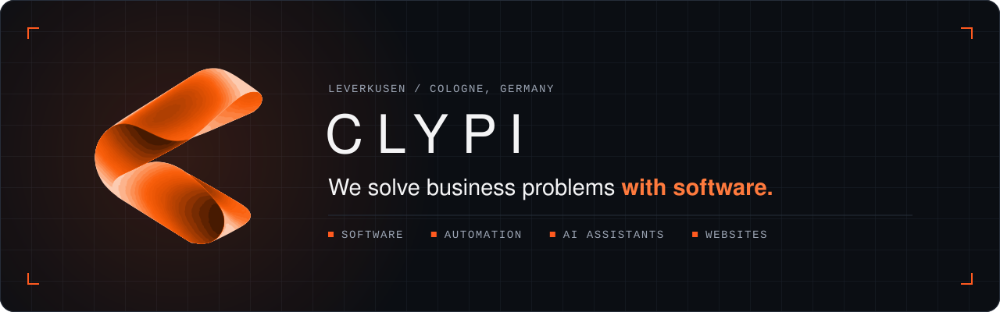

<picture>
  <source media="(prefers-color-scheme: dark)" srcset="./assets/banner-dark.svg">
  <source media="(prefers-color-scheme: light)" srcset="./assets/banner-light.svg">
  
</picture>

  
  
  

  CLYPI builds custom software, automates recurring work and develops AI assistants and websites 
  for small and medium-sized businesses. Based in Leverkusen, right next to Cologne.

## What we build

<table>
  <tr>
    <td width="50%" valign="top">
      <h3>Software development</h3>
      Business applications, CRM, internal tools and dashboards, APIs and integrations. Built around the steps your team takes every day.
    </td>
    <td width="50%" valign="top">
      <h3>Process automation</h3>
      Inquiry handling, appointment reminders, document processing and data sync, so nobody retypes data from one program into the next.
    </td>
  </tr>
  <tr>
    <td width="50%" valign="top">
      <h3>AI assistants</h3>
      Phone assistants, inquiry pre-sorting and reading details out of documents. We use AI where it does a task reliably, and nowhere else.
    </td>
    <td width="50%" valign="top">
      <h3>Web development</h3>
      Business websites, customer portals, booking platforms and web apps that load fast and send inquiries straight into your workflows.
    </td>
  </tr>
</table>

## How we work

<table>
  <tr><td><b>01 · Understand first, then build</b></td><td>The first call is about how your work runs, not about technology.</td></tr>
  <tr><td><b>02 · A fixed price before we start</b></td><td>A written offer with a clear scope after a free first call.</td></tr>
  <tr><td><b>03 · You talk to the developers</b></td><td>A small team on purpose: the people who plan your software also write it.</td></tr>
  <tr><td><b>04 · AI only where it helps</b></td><td>Where a simple rule is enough, we build the simple rule.</td></tr>
  <tr><td><b>05 · Hosted in the EU</b></td><td>We work with you in German, English or Turkish.</td></tr>
</table>

## Stack

  
  
  
  
  
  
  

## Get in touch

Tell us where your business gets stuck: [hello@clypi.de](mailto:hello@clypi.de) or the contact form on [clypi.de](https://www.clypi.de/en).

---

CLYPI is a brand of Hoymes Invest GmbH, Leverkusen, Germany.

